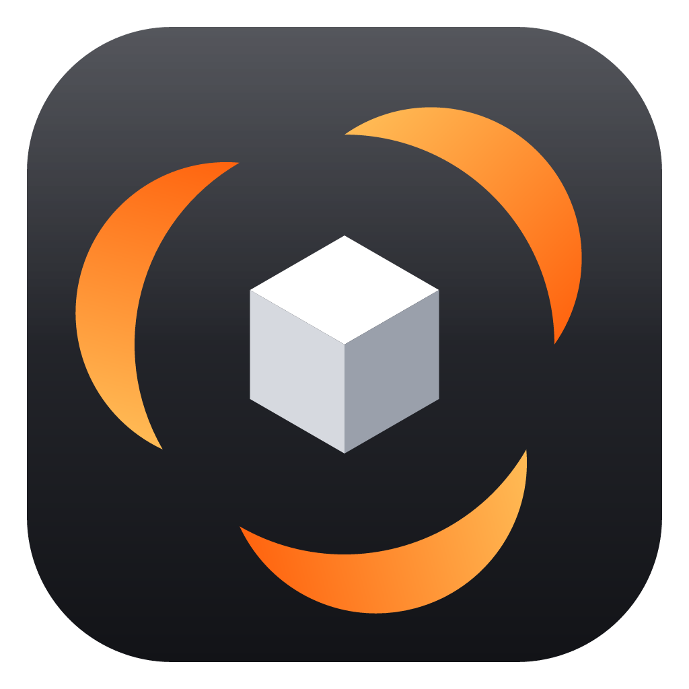
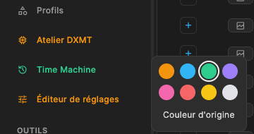
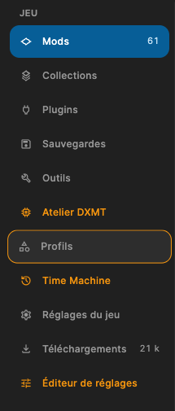

<p align="center"></p>

# mORTEX

[](https://openmacapps.com/apps/mortex/) [](https://github.com/starbudweiser/mORTEX/releases/latest) [](LICENSE.md)

**Unofficial macOS port of the Vortex mod manager, for Skyrim Special Edition running under CrossOver.**

🇬🇧 English · 🇫🇷 [Français](#français)

## About

mORTEX is an unofficial macOS (Apple Silicon) port of [Vortex](https://github.com/Nexus-Mods/Vortex), the Nexus Mods mod manager. It manages Skyrim Special Edition running in a Wine bottle (CrossOver). It is neither affiliated with nor endorsed by Nexus Mods.

mORTEX Mods Manager is maintained by Starbudweiser & Claude Code (Anthropic). GPL-3.0 License, like Vortex. Provided as is, without warranty of any kind. See **About mORTEX** in the app menu.

## Features

- Skyrim SE detection in CrossOver bottles; the game and tools launch inside the bottle.
- `nxm://` links ("Mod Manager Download"), mod installation (`.zip`, `.7z`, `.rar`) and XML FOMODs.
- Hardlink deployment (the staging folder must be on the same volume as the game) and clean purge.
- Automatic plugin sorting with LOOT (libloot 0.29).

### Sidebar in your order

Grab a sidebar entry and move it up or down within its group (Game, Tools, Application); it lifts off (orange outline, drop shadow), follows the pointer, and the other entries slide aside to make room. The order is kept between launches.

Option + right-click an entry to open a small palette and give it a colour; "Original colour" puts it back.





### Known limits

- C# FOMOD scripts are not supported (XML FOMOD only).
- Skyrim SE only for now; no auto-update and no telemetry.

## Install

**[Download the latest notarized release](https://github.com/starbudweiser/mORTEX/releases/latest)** (`mORTEX-…-mac-arm64.zip`), unzip it and move **mORTEX.app** to your Applications folder. Requires an Apple Silicon Mac with **macOS 14 Sonoma** or later, and CrossOver for the game.

## Build

```bash
source mac/env.sh      # Node 24 and pnpm
mac/rebuild.sh         # dependencies and native addons (7zz, FOMOD NativeAOT, libloot)
mac/package.sh         # builds, signs and installs mORTEX.app
```

Requirements: Homebrew (`node@24`, `dotnet`, `cmake`), Rust (rustup), Xcode.

## Languages

English, French, Spanish and Italian. The app follows your Mac's preferred language automatically (English if it is none of these four).

## Support

💬 Help and community: [Skyrim Mac Toolkit Discord](https://discord.gg/jRS4rvynx6) · bug reports: [GitHub Issues](https://github.com/starbudweiser/mORTEX/issues). Please do not report mORTEX issues to Nexus Mods or the Vortex team.

## License

GPL-3.0 licensed, like Vortex. See [NOTICE-mORTEX.md](NOTICE-mORTEX.md). Third-party components added for macOS (7-Zip, The Unarchiver, libloot, fomod-installer, node-loot) are listed with their licences in [NOTICE-mORTEX.md](NOTICE-mORTEX.md).

## Based on Vortex

mORTEX is a derivative work of [Vortex](https://github.com/Nexus-Mods/Vortex) © Black Tree Gaming Ltd. / Nexus Mods, released under the [GPL-3.0](https://github.com/Nexus-Mods/Vortex/blob/master/LICENSE.md) license. "Nexus Mods" and "Vortex" are their owners' trademarks.

<details>
<summary>Original Vortex README</summary>

<p align="center">
  
</p>

<p align="center">  
<a href="https://discord.gg/nexusmods"></a>
<a href="https://twitter.com/nexussites"></a>
<a href="https://www.youtube.com/c/NexusModsYT"></a>
<a href="https://www.instagram.com/nexusmodsofficial/"></a>
<a href="https://www.reddit.com/r/nexusmods/"></a>
<a href="https://www.facebook.com/nexussites/"></a>
</p>

#### Introduction

Vortex is the current mod manager from Nexus Mods. It is designed to make modding your game as simple as possible for new users, while still providing enough control for more experienced veterans of the modding scene.

Our approach with Vortex aims to take complex tasks such as sorting your load order or managing your mod files and automate as much of the process as possible with the goal of having you achieve a stable modded game with minimal effort. We want to help you spend less time modding and more time playing your games.

#### Features

- **Multi-game Support** - with mod support for over 250 different games and counting, Vortex is the most versatile mod manager available. This includes games such as [Skyrim](https://www.nexusmods.com/skyrimspecialedition), [Fallout 3](https://www.nexusmods.com/fallout3), [Fallout 4](https://www.nexusmods.com/fallout4), [Fallout: New Vegas](https://www.nexusmods.com/newvegas/), [Cyberpunk 2077](https://www.nexusmods.com/cyberpunk2077/), [Baldur's Gate 3](https://www.nexusmods.com/baldursgate3/), [Starfield](https://www.nexusmods.com/starfield/), [Stardew Valley](https://www.nexusmods.com/stardewvalley/), [Bannerlord](https://www.nexusmods.com/mountandblade2bannerlord), [Witcher 3](https://www.nexusmods.com/witcher3), [Elden Ring](https://www.nexusmods.com/eldenring), [The Sims 4](https://www.nexusmods.com/thesims4), [Monster Hunter: World](https://www.nexusmods.com/monsterhunterworld), [Oblivion](https://www.nexusmods.com/oblivion), [Palworld](https://www.nexusmods.com/palworld), [Blade & Sorcery](https://www.nexusmods.com/bladeandsorcery), [Valheim](https://www.nexusmods.com/valheim), [Hogwarts Legacy](https://www.nexusmods.com/hogwartslegacy/), [7 Days to Die](https://www.nexusmods.com/7daystodie/).

- **Close integration with Nexus Mods** - Vortex is designed to seamlessly interact with Nexus Mods, allowing you to easily find, install, and play mods from our site, learn about new files and catch the latest news.

- **Modding made easy** - The built-in auto-sorting system manages your load order and helps you to resolve mod conflicts with powerful, yet easy to use plugin management features.

- **Mod Profiles** - Easily set up, switch between, and manage independent mod profiles, enabling you to use exactly the combination of mods that you want for a particular playthrough.

- **Modern, Easy-to-use UI** - Featuring a fully customisable interface, Vortex allows you to quickly and easily access tools and manage your games, plugins, downloads and save games.

- **Extensions and Plugins** - Vortex is released under a GPL-3.0 License, giving our community the ability to write extensions and frameworks which can then interact with Vortex, continually adding to its functionality.

#### Getting Started

To get started, Vortex can be downloaded from [Nexus Mods](https://www.nexusmods.com/site/mods/1?tab=files) or from [GitHub](https://github.com/Nexus-Mods/Vortex/releases/latest). After the installer has been downloaded, just run it and follow the instructions.

Additional information on Vortex and guides can be found in the [Vortex Wiki](https://github.com/Nexus-Mods/Vortex/wiki).

#### Resources

- [Download Vortex](https://www.nexusmods.com/site/mods/1?tab=files) from Nexus Mods
- [GitHub](https://github.com/Nexus-Mods/Vortex) for source code, issues, and pull requests.
- [Vortex Forum](https://forums.nexusmods.com/index.php?/forum/4306-vortex-support/) or [Discord](https://discord.gg/nexusmods) for support and discussions with the community and the team.
- [Vortex Wiki](https://github.com/Nexus-Mods/Vortex/wiki) for knowledge base, articles and troubleshooting

#### Contributing

The majority of Vortex code is open-source. We are committed to a transparent development process and highly appreciate any contributions. Whether you are helping us fix bugs, proposing new features, improving our documentation or spreading the word - we would love to have you as a part of the Vortex community.

- Bug Report: If you see an error message or encounter an issue while using our application, please create a [bug report](https://github.com/Nexus-Mods/Vortex/issues/new?assignees=&labels=&projects=&template=bug_report.md&title=).
- Feature Request: If you have an idea or if there is a capability that is missing and would make development easier and more robust, please submit a [feature request](https://github.com/Nexus-Mods/Vortex/issues/new?assignees=&labels=&projects=&template=feature_request.md&title=).
- Pull Request: Read [CONTRIBUTING.md](CONTRIBUTING.md) first. We are in the middle of large foundational changes and can only take small pull requests at the moment, so check with us before starting anything big.

#### Developing

To build and run Vortex from source, start with [CONTRIBUTING.md](./CONTRIBUTING.md). It covers setup for each platform, the build/run/hot-reload workflow, debugging, and packaging. Deeper guides (debugging, packaging, the auto-updater, release process) are indexed in [docs/README.md](./docs/README.md).

#### License

This project is licensed under the [GPL-3.0](https://github.com/Nexus-Mods/Vortex/blob/master/LICENSE.md) license.

</details>

---

## Français

**Portage macOS non officiel du gestionnaire de mods Vortex, pour Skyrim Special Edition sous CrossOver.**

💬 Aide et communauté : [Discord du Skyrim Mac Toolkit](https://discord.gg/jRS4rvynx6)

mORTEX est un portage macOS (Apple Silicon) non officiel de [Vortex](https://github.com/Nexus-Mods/Vortex), le gestionnaire de mods de Nexus Mods. Il gère Skyrim Special Edition lancé dans une bouteille Wine (CrossOver). Il n'est ni affilié à Nexus Mods ni approuvé par elle.

### Ce qui fonctionne

- Détection de Skyrim SE dans les bouteilles CrossOver, lancement du jeu et des outils dans la bouteille.
- Liens `nxm://` (« Mod Manager Download »), installation de mods (`.zip`, `.7z`, `.rar`) et de FOMOD XML.
- Déploiement par liens physiques (le dossier de staging doit être sur le même volume que le jeu) et retrait propre.
- Tri automatique des plugins avec LOOT (libloot 0.29).

### Barre latérale à votre ordre

Saisissez une entrée de la barre latérale et faites-la monter ou descendre dans son groupe (Jeu, Outils, Application) : elle décolle (contour orange, ombre portée), suit le curseur, et les autres entrées glissent pour lui faire place. L'ordre est retenu d'un lancement à l'autre.

Option + clic droit sur une entrée ouvre une petite palette pour lui donner une couleur ; « Couleur d'origine » la rend comme avant.


### Installer

```bash
source mac/env.sh      # Node 24 et pnpm
mac/rebuild.sh         # dépendances et addons natifs (7zz, FOMOD NativeAOT, libloot)
mac/package.sh         # construit, signe et installe mORTEX.app
```

Prérequis : Homebrew (`node@24`, `dotnet`, `cmake`), Rust (rustup), Xcode.

### Limites connues

- Scripts FOMOD en C# non pris en charge (seul le FOMOD XML l'est).
- Skyrim SE uniquement pour l'instant ; pas de mise à jour automatique ni de télémétrie.

Licence GPL-3.0 comme Vortex. Voir [NOTICE-mORTEX.md](NOTICE-mORTEX.md).
